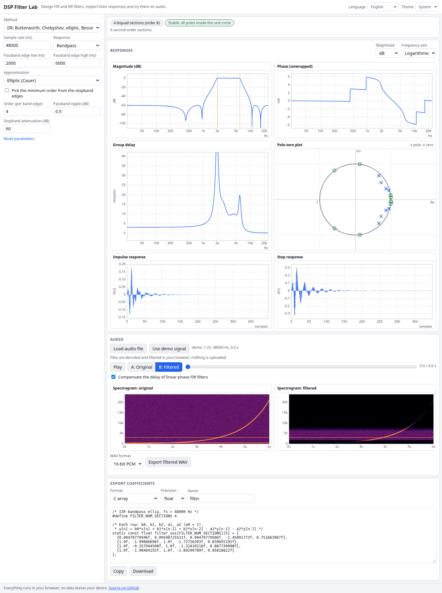

# DSP Filter Lab

A signal-processing lab in the browser. Design FIR and IIR digital filters, inspect magnitude, phase, group delay, impulse, step and pole-zero plots, run audio through the filter with A/B playback and spectrograms, then export the coefficients as C, Python (scipy), CSV or Q15/Q31 fixed-point.

**Try it: [hermes98761234.github.io/dsp-filter-lab](https://hermes98761234.github.io/dsp-filter-lab/)**

[](https://github.com/hermes98761234/dsp-filter-lab/actions/workflows/deploy.yml)



## Features

- **FIR design.** Windowed sinc (rectangular, Bartlett, Hann, Hamming, Blackman, Blackman-Harris, Nuttall, Kaiser), Kaiser with automatic beta and length from attenuation and transition width, Parks-McClellan equiripple (Remez exchange, with an automatic search for the shortest length that meets a ripple spec), and frequency sampling. Lowpass, highpass, bandpass, bandstop, differentiator and Hilbert transformer.
- **IIR design.** Butterworth, Chebyshev I and II, elliptic and Bessel through the bilinear transform with frequency prewarping, output as cascaded biquads (SOS). Give an order or let it pick the minimum order from passband and stopband edges.
- **Audio EQ.** Robert Bristow-Johnson cookbook biquads (peaking, low/high shelf, notch, lowpass, highpass, bandpass, allpass) as a cascade of up to 12 bands.
- **Manual design.** Drag poles and zeros around the unit circle and watch the responses change; complex items move with their conjugate.
- **Plots.** Magnitude (dB or linear), unwrapped phase, group delay, impulse and step response, pole-zero plot with the unit circle. Linear or logarithmic frequency axis, hover read-out.
- **Audio.** Load a file (any format the browser decodes) or use a demo chirp. A/B playback of original and filtered audio, spectrograms before and after, export the filtered WAV (16-bit or 32-bit float).
- **Export.** C array, Python/scipy, CSV, Q15 and Q31 fixed-point (with block exponent and an optional CMSIS-DSP layout).
- **English and Ukrainian, light/dark/system theme**, settings remembered in the browser. No backend and no tracking: files never leave your device.

## How it works

All the maths is in `src/lib` as pure functions with unit tests, checked against textbook formulas and scipy reference values.

- Analog prototypes (Butterworth, Chebyshev, Bessel polynomial roots, elliptic via Jacobi elliptic functions and the degree equation) are mapped to the target band with lowpass-to-X transforms, prewarped, passed through the bilinear transform, and paired into second-order sections.
- Remez builds a dense grid, solves for the reference-set error with barycentric interpolation, and exchanges extremal points until the error alternates equally. The four linear-phase types are reduced to one cosine-series problem.
- Filtering uses transposed direct form II biquads in double precision, and FFT overlap-add for FIR. Design, analysis, filtering and spectrograms run in a Web Worker.

Tests cover: Butterworth -3 dB at the cutoff, Chebyshev/elliptic ripple bounds, magnitude responses equal to scipy for all five IIR families, SOS stability, Remez coefficients equal to scipy and equiripple within spec, Kaiser attenuation, RBJ gains, export formats, WAV header, and filtering a tone.

## Quick start

You need [Node.js](https://nodejs.org/) 22.

```bash
git clone https://github.com/hermes98761234/dsp-filter-lab.git
cd dsp-filter-lab
npm install
npm run dev       # http://localhost:5173
npm test          # DSP maths, export and i18n tests
npm run build     # static site in dist/
```

## License

MIT
